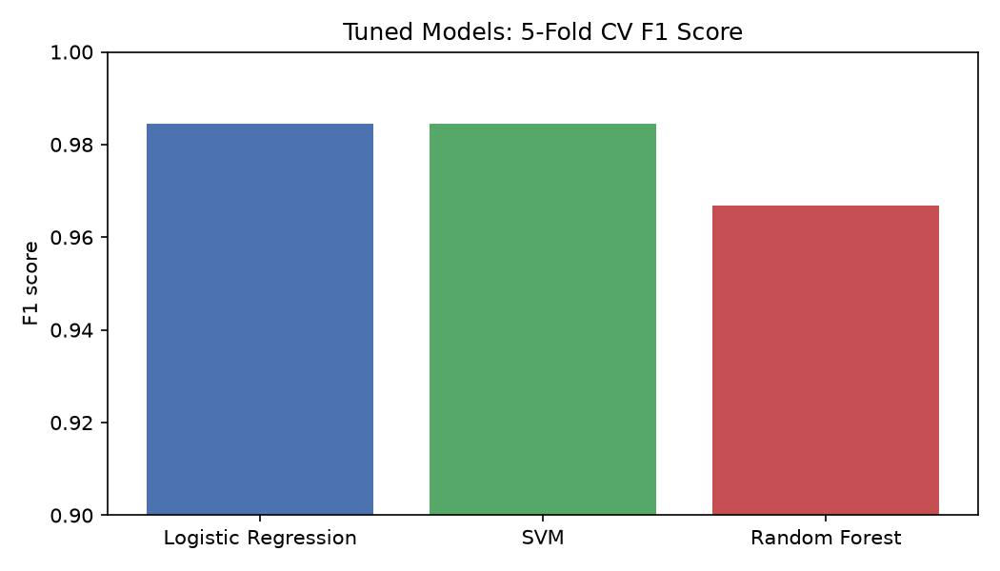
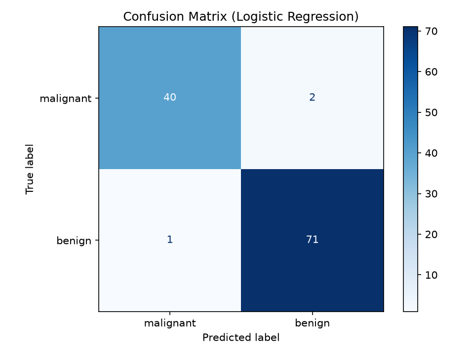
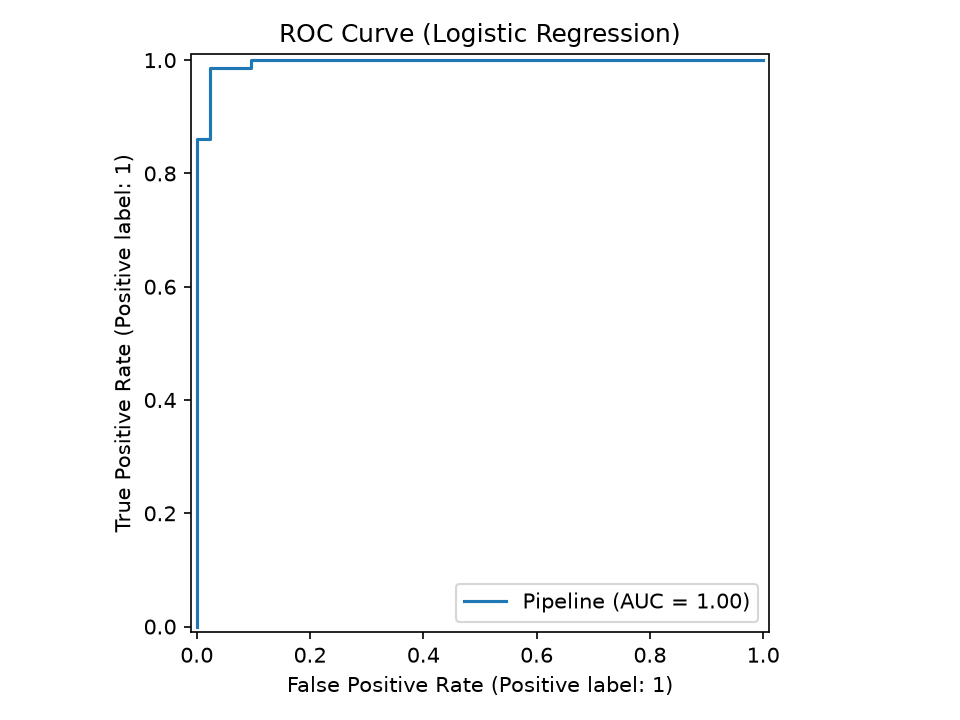
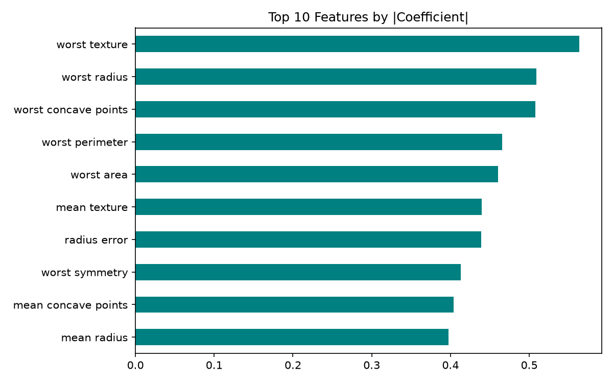

# Breast Cancer Prediction using Machine Learning

Classifies tumors as **malignant** or **benign** using the Breast Cancer Wisconsin dataset (built into scikit-learn).

**Author:** Rohit Basera
**Roll No:** 2300650100096
**College:** BSA College of Engineering and Technology
**Submitted to:** Aashna Khushwaha

---

## Problem
Early and accurate diagnosis of breast cancer greatly improves survival. This project builds a machine learning model that predicts whether a tumor is malignant or benign from 30 measurements of cell nuclei, and measures its performance on patients it has never seen.

## Dataset
- Source: Breast Cancer Wisconsin (Diagnostic), loaded with `sklearn.datasets.load_breast_cancer`
- 569 patients, 30 numeric features (radius, texture, perimeter, area, smoothness, concavity, etc.; each as mean, error and worst value)
- 357 benign, 212 malignant
- Split: 80% training (455) / 20% unseen test (114), stratified to keep the class ratio

## Methodology
1. Load the data
2. Stratified 80/20 train/test split
3. Scale features with `StandardScaler` (inside a `Pipeline`)
4. Tune three models with `GridSearchCV` (5-fold cross-validation, F1 score): Logistic Regression, SVM, Random Forest
5. Automatically select the model with the best cross-validated F1
6. Evaluate on the unseen test set
7. Validate stability with repeated stratified cross-validation (5 folds x 3 repeats) on all data

## Results

### Model comparison (tuned, 5-fold CV F1 on training data)

| Model | CV F1 | Best parameters |
|---|---|---|
| **Logistic Regression (selected)** | **0.9845** | C = 0.1 |
| SVM | 0.9844 | C = 10, gamma = 0.01 |
| Random Forest | 0.9668 | n_estimators = 300, max_depth = None, min_samples_split = 2 |

Logistic Regression scored highest, so it was selected as the final model.

### Final model on the unseen test set (114 patients)

| Metric | Score |
|---|---|
| Accuracy | 0.9737 (111 of 114 correct) |
| Precision (benign) | 0.9726 |
| Recall (benign) | 0.9861 |
| F1 (benign) | 0.9793 |
| ROC-AUC | 0.9957 |
| Repeated CV accuracy (all data, 15 runs) | 0.9742 (+/- 0.0130) |

Per-class results:

| Class | Precision | Recall | F1 | Support |
|---|---|---|---|---|
| Malignant | 0.98 | 0.95 | 0.96 | 42 |
| Benign | 0.97 | 0.99 | 0.98 | 72 |

Confusion matrix: 40 malignant correctly found, 2 malignant missed, 1 false alarm, 71 benign correctly found.

The repeated cross-validation accuracy (97.4%) matches the test accuracy, so the result is stable and not luck from one split.

### Most influential features
1. worst texture
2. worst radius
3. worst concave points

These describe the largest and most irregular cell nuclei, which fits how malignant cells look.

### Plots (in the `outputs/` folder)






## Scalability demo
To demonstrate scalability, the trained model was applied to **24,999 simulated patients** generated from the statistics (mean and covariance, per class) of the real dataset: 8,841 predicted malignant and 16,158 predicted benign. This is a demonstration only. **All reported accuracy comes from the 569 real patients.** Predictions are saved in `outputs/simulated_predictions.csv`.

## Project structure
```
train.py                       # tunes 3 models, picks the best, evaluates, saves plots and model
predict.py                     # predicts 5 sample patients with the saved model
predict_large.py               # scores ~25,000 simulated patients
requirements.txt               # dependencies
outputs/
  model.joblib                 # trained model
  metrics.csv                  # test metrics
  model_comparison.png
  confusion_matrix.png
  roc_curve.png
  feature_importance.png
  simulated_predictions.csv
```

## How to run
```
pip install -r requirements.txt
python train.py
python predict.py
python predict_large.py
```

## Limitations and future work
- 2 malignant cases were missed on the test set, which matters in medicine
- Future work: recall-focused tuning, testing on a larger real hospital dataset, a Streamlit web app, trying XGBoost and neural networks

## Disclaimer
This is an educational project and must not be used for real medical diagnosis.